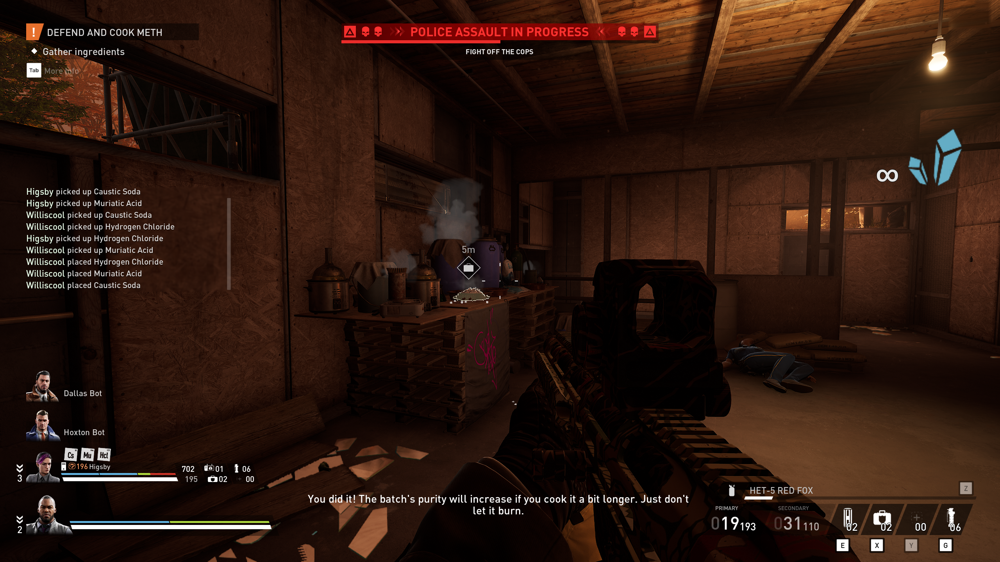

# Meth Lab HUD

A PAYDAY 3 UE4SS mod: a meth lab status icon with the next ingredient, the
cooking progress, and when the batch is ready. Works in Cook Off and Party Powder.



- **Players:** download it from [Nexus Mods](https://www.nexusmods.com/payday3/mods/498) or from [Releases](https://github.com/Williscool13/MethLabHUD/releases).
- **Settings in game:** works with [Will's Mod Menu](https://github.com/Williscool13/WillsModMenu) (optional); changes apply at once.

Requires [UE4SS for PAYDAY 3](https://www.nexusmods.com/payday3/mods/266).
Tested with UE4SS v3.0.1 Beta.

## Features

- The next ingredient on the icon (CS, MU, HCL); the bag fills as ingredients go in.
- Every lab state: cooking, perfect, burnt, power cut, destroyed. Dots while the lab processes a pour.
- The "meth ready" sound, also played so you hear it anywhere on the map.
- How many more bags the lab can make.
- Only what the player would know: in Party Powder the recipe shows once you or a teammate has seen it; in Cook Off the icon follows Shade's calls and shows "?" while she might still correct herself.
- Optional markers over ingredient pickups (off by default).
- Styles: a fixed spot on the HUD, over the lab, or both.

## Layout

| Path | What |
|---|---|
| `MethCook/` | The mod (dev build): `Scripts/main.lua`, `settings.ini`, `settings.schema.json`. The folder keeps the mod's working name. |
| `docs/FINDINGS.md` | What the mod relies on: the cooking station, both heists' recipes, Shade's Cook Off dialogue, UE4SS pitfalls |
| `docs/screens/` | Screenshots |
| `tests/` | A mock world (`methsim.py`, Python + [lupa](https://pypi.org/project/lupa/)) and scenario scripts |
| `build_release.py` | Strips dev-only code, checks it, writes `release/MethLabHUD-<version>.zip` |

## Development

To try the dev build, copy `MethCook/` into `PAYDAY3\PAYDAY3\Binaries\Win64\ue4ss\Mods\`.
Restart the game after changing the Lua file.

Release builds leave out development-only code: any line ending in `-- @dev`,
and everything between `-- @dev-begin` and `-- @dev-end`.

### Tests

Python 3 with lupa (`pip install lupa`), run from the repo root:

```
python tests/methsim.py MethCook/Scripts/main.lua                      # base scenario
python tests/methsim.py MethCook/Scripts/main.lua tests/cooktail.lua   # one scenario script
```

Each scenario script prints a line ending in `OK` when it passes, except
`perftail.lua`, which prints the per-frame cost.

## Related mods

- [Will's Mod Menu](https://github.com/Williscool13/WillsModMenu) ([Nexus](https://www.nexusmods.com/payday3/mods/505)): change this mod's settings in game.
- [SentryHeat](https://github.com/Williscool13/SentryHeat) ([Nexus](https://www.nexusmods.com/payday3/mods/497)): sentry heat, Machine War bonus and kills.

## License

[MIT](LICENSE).
